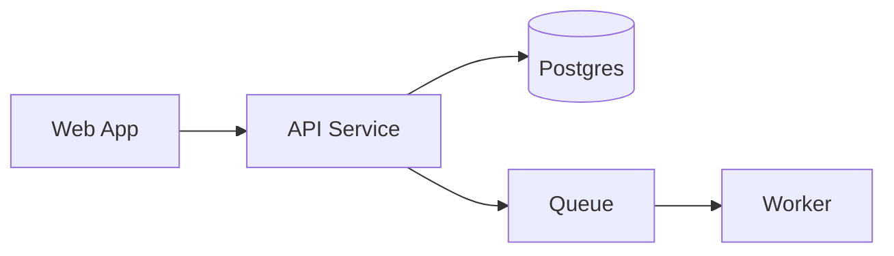
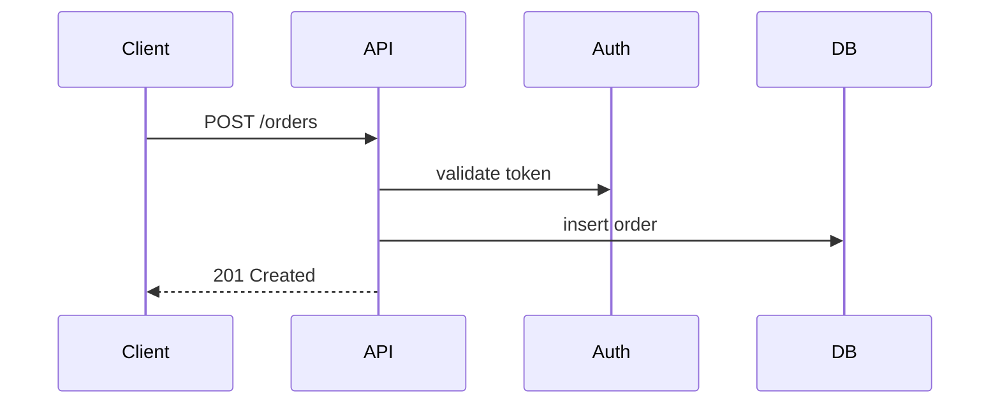
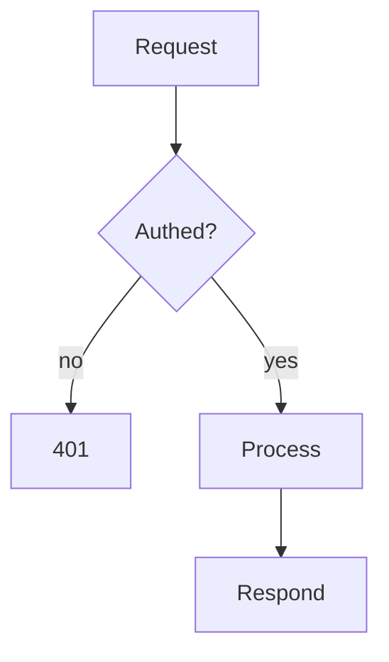

# Onboarding Docs Generator

**Goal:** a new engineer understands as much of this codebase as possible, as fast as possible. Optimise for time-to-understanding, not completeness.

## Process

1. **Recon** — read before writing:
   - `README*`, `CONTRIBUTING*`, `docs/`, `AGENTS.md`/`CLAUDE.md`, ADRs
   - Manifests: `package.json`, `*.csproj`, `pom.xml`, `pyproject.toml`, `go.mod`, etc.
   - Dir tree (2–3 levels), entry points (`main`, `Program.cs`, `index`, route files)
   - Config / env (`*.yml`, `appsettings*`, `.env.example`, docker/compose, IaC)
   - Test setup (test dirs, runner config, CI pipeline files)
2. **Map** — identify, in your head first:
   - Apps/services and how they talk (topology)
   - The 1–3 *most important* request/data flows (the happy paths)
   - Data stores + key external deps
   - How tests are structured and run
3. **Decide what to write (1–4 docs)** — let the codebase dictate it, not a template. Ask: *what does a new engineer most need to grok here?* Carve the docs around the real answers. Don't pad to hit four; don't cram everything into one.
4. **Draft** to `/docs/onboard/` using the kiss style rules.
5. **Verify** — every diagram references real files/components you actually saw. Flag guesses as `> ⚠️ assumption`.

## Style rules (apply to every doc)

- Lead with a 1-line answer to "what is this / what does this show".
- No walls of text. Skimmable in seconds. Short paras (1–3 sentences).
- Prefer **mermaid diagrams, tables, dot points** over prose.
- Separate ideas with blank lines, not just headings.
- Link to real paths: `` `src/api/orders.ts` `` so readers can jump in.
- End each doc with **"Where to look next"** — files to open.

## Choosing the docs (flexible — these are candidates, not a checklist)

There are no fixed files. Split by whatever cuts the codebase cleanly. Common things worth a doc *if they matter here*:

- **Orientation** — what it is, tech stack, repo map, how to run
- **Key flow(s)** — the happy path(s): a request, a job, a data pipeline
- **Architecture / topology** — services, stores, external deps, boundaries
- **Testing** — layers, how to run, where tests live
- **Domain model** — core entities + relationships, if the domain is the hard part
- ...or whatever is genuinely the crux of *this* repo

Rules of thumb:
- 1 doc for a small/single-purpose repo; up to 4 for a large or multi-service one.
- One concern per doc. Merge thin ones; split a doc that's becoming a wall.
- Name files for what they hold, numbered for reading order: `00-orientation.md`, `01-order-flow.md`, etc. The names above are examples — pick what fits.

## Diagram patterns

**Topology** (`graph`):

**Happy path** (`sequenceDiagram`):

**Logic flow** (`flowchart`):

**Tech stack / test layers** → use a table, not prose.

## Checklist before finishing

- [ ] 1–4 docs in `/docs/onboard/`, scoped to what this repo needs, none a wall of text
- [ ] Key flow(s) shown as sequence/flow diagrams where a flow exists
- [ ] Topology diagram where there's more than one moving part
- [ ] Every component named maps to a real file/dir
- [ ] Assumptions marked `> ⚠️`; gaps noted rather than invented
- [ ] Each doc ends with "Where to look next"
